# Model Experiment Results

This project compares five models (Gradient Boosting, Random Forest, SVR, Ridge, Lasso) under three task settings: **3-class**, **6-class**, and **10-class**. Models are evaluated with MSE, RMSE, MAE, and R².

> 💡 Click a model name in any comparison table to jump to its result figure.

## Table of Contents

- [3-Class Task](#3-class-task)
- [6-Class Task](#6-class-task)
- [10-Class Task](#10-class-task)
- [Metrics](#metrics)

---
## GroundTruth BERT

  

<em>Bert-based model, the best one.</em>

| MSE ↓ | RMSE ↓ | MAE ↓ | R² ↑ |
7.57%	27.51%	9.43%	96.01%

## 3-Class Task

### Model Comparison (3-Class)

| Model | MSE ↓ | RMSE ↓ | MAE ↓ | R² ↑ |
|:---|:---:|:---:|:---:|:---:|
| **[Gradient Boosting](#3c-gb)** | **0.1796** | **0.4238** | **0.3032** | **0.6623** |
| [Random Forest](#3c-rf) | 0.1945 | 0.4411 | 0.3067 | 0.6342 |
| [SVR](#3c-svr) | 0.2009 | 0.4482 | 0.3330 | 0.6222 |
| [Ridge](#3c-ridge) | 0.3892 | 0.6239 | 0.5237 | 0.2681 |
| [Lasso](#3c-lasso) | 0.6226 | 0.7891 | 0.6536 | -0.1708 |

> Best model: **Gradient Boosting** (R² = 0.6623)

### Result Visualization (3-Class)

#### Gradient Boosting

  

<em>Figure 1. 3-Class – Gradient Boosting.</em>

Description: _Write your description here._

[↑ Back to table](#3c-table)

#### Random Forest

  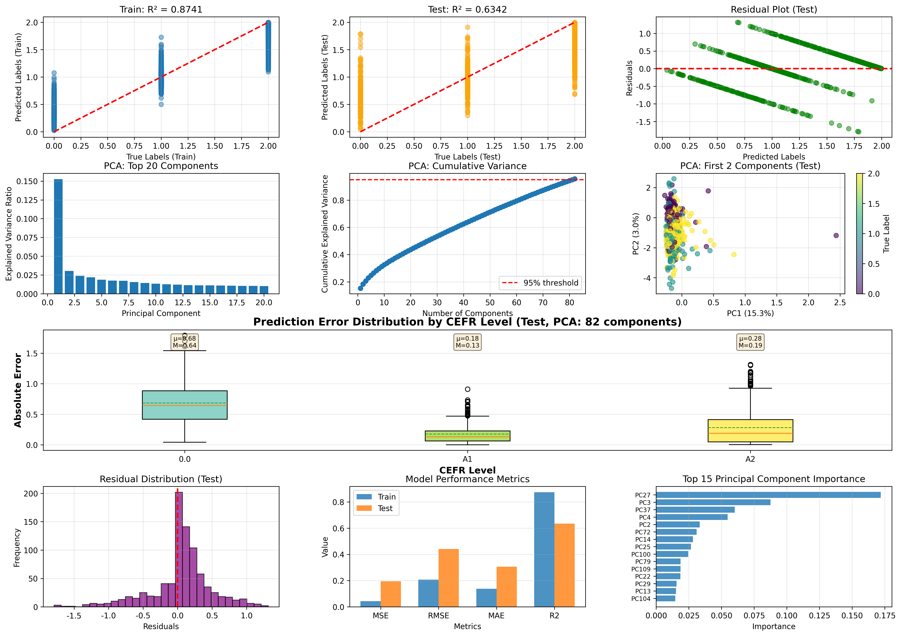

<em>Figure 2. 3-Class – Random Forest.</em>

Description: _Write your description here._

[↑ Back to table](#3c-table)

#### SVR

  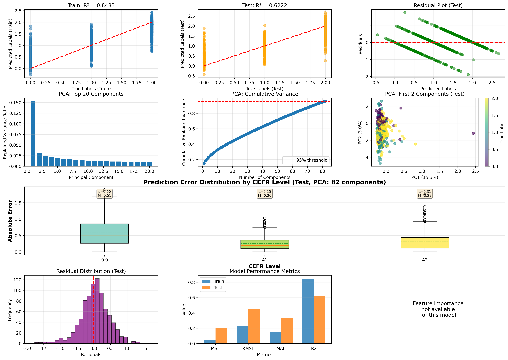

<em>Figure 3. 3-Class – SVR.</em>

Description: _Write your description here._

[↑ Back to table](#3c-table)

#### Ridge

  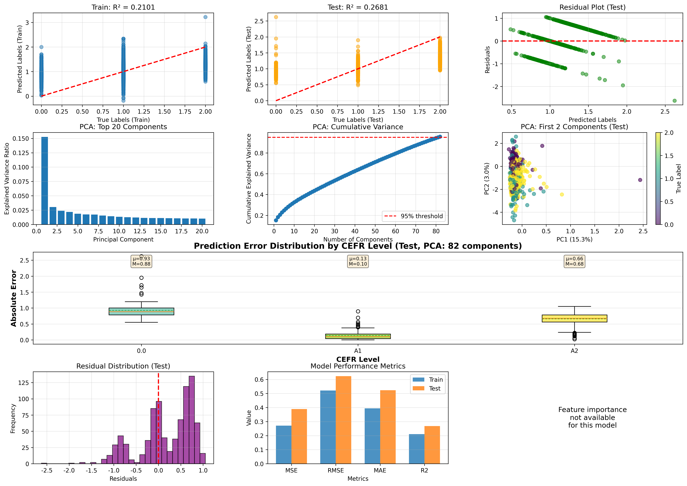

<em>Figure 4. 3-Class – Ridge.</em>

Description: _Write your description here._

[↑ Back to table](#3c-table)

#### Lasso

  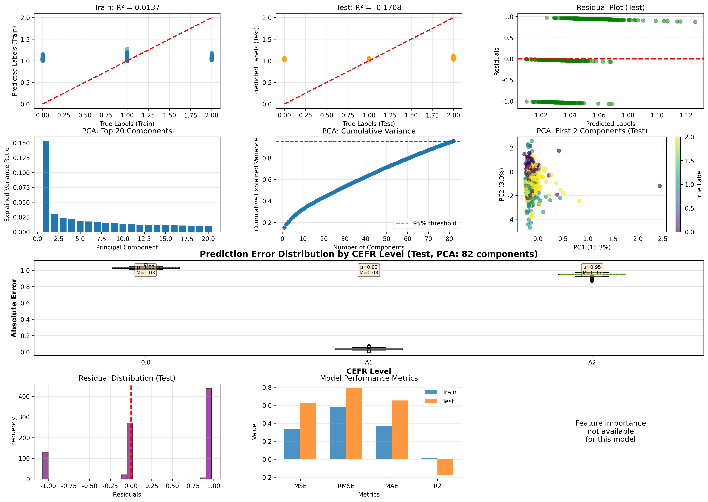

<em>Figure 5. 3-Class – Lasso.</em>

Description: _Write your description here._

[↑ Back to table](#3c-table)

---

## 6-Class Task

### Model Comparison (6-Class)

| Model | MSE ↓ | RMSE ↓ | MAE ↓ | R² ↑ |
|:---|:---:|:---:|:---:|:---:|
| **[Gradient Boosting](#6c-gb)** | **0.8223** | **0.9068** | 0.6647 | **0.6574** |
| [Random Forest](#6c-rf) | 0.8521 | 0.9231 | **0.6553** | 0.6450 |
| [SVR](#6c-svr) | 0.8900 | 0.9434 | 0.7029 | 0.6291 |
| [Ridge](#6c-ridge) | 1.8255 | 1.3511 | 1.1251 | 0.2394 |
| [Lasso](#6c-lasso) | 2.4241 | 1.5569 | 1.3250 | -0.0101 |

> Best model: **Gradient Boosting** (R² = 0.6574); Random Forest is slightly better on MAE.

### Result Visualization (6-Class)

#### Gradient Boosting

  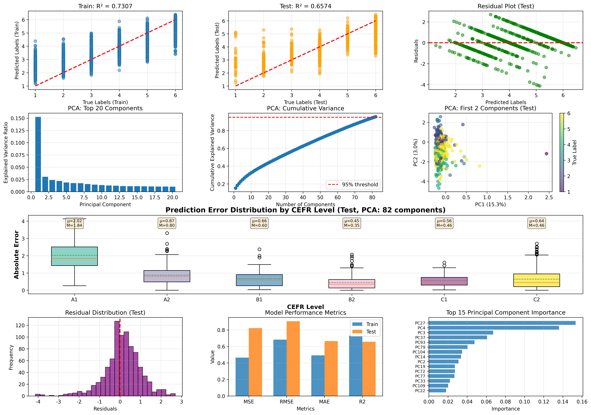

<em>Figure 6. 6-Class – Gradient Boosting.</em>

Description: _Write your description here._

[↑ Back to table](#6c-table)

#### Random Forest

  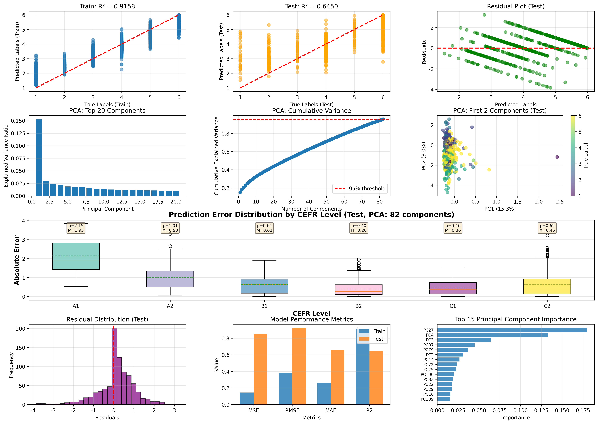

<em>Figure 7. 6-Class – Random Forest.</em>

Description: _Write your description here._

[↑ Back to table](#6c-table)

#### SVR

  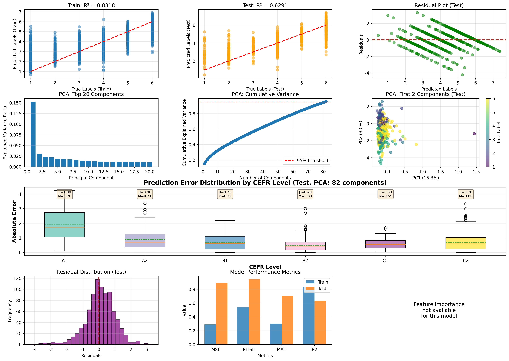

<em>Figure 8. 6-Class – SVR.</em>

Description: _Write your description here._

[↑ Back to table](#6c-table)

#### Ridge

  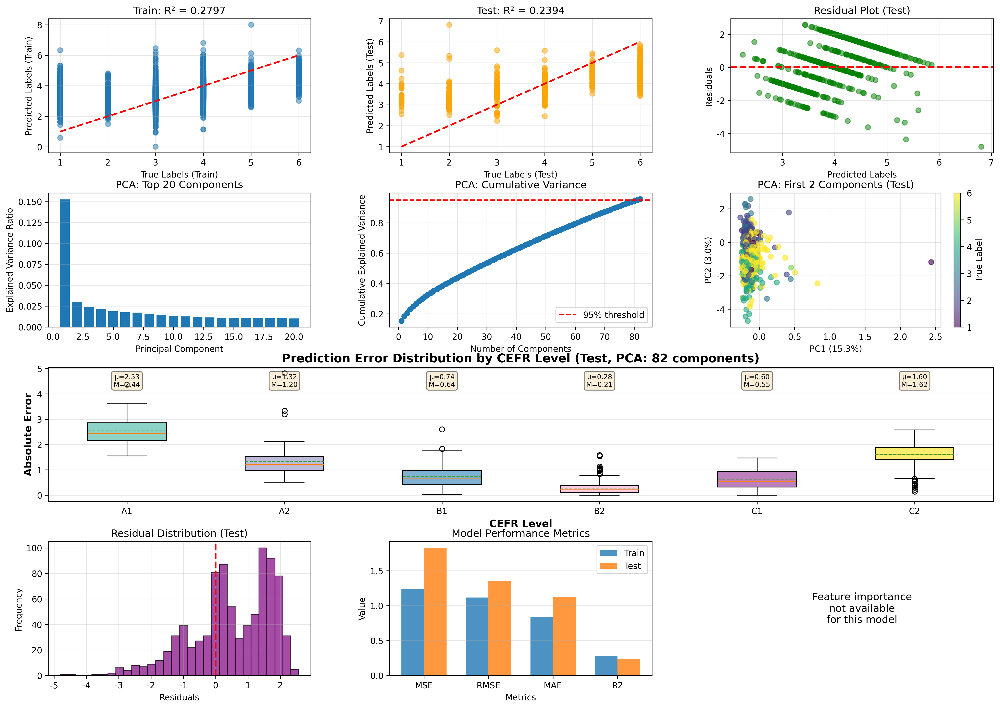

<em>Figure 9. 6-Class – Ridge.</em>

Description: _Write your description here._

[↑ Back to table](#6c-table)

#### Lasso

  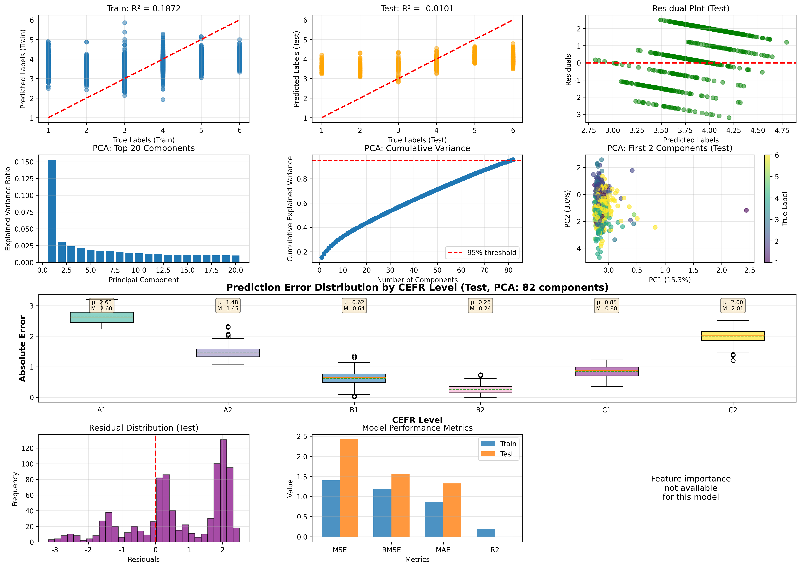

<em>Figure 10. 6-Class – Lasso.</em>

Description: _Write your description here._

[↑ Back to table](#6c-table)

---

## 10-Class Task

### Model Comparison (10-Class)

| Model | MSE ↓ | RMSE ↓ | MAE ↓ | R² ↑ |
|:---|:---:|:---:|:---:|:---:|
| **[Gradient Boosting](#10c-gb)** | **1.9733** | **1.4048** | **1.2206** | **-0.0409** |
| [Random Forest](#10c-rf) | 2.2294 | 1.4931 | 1.2984 | -0.1760 |
| [Lasso](#10c-lasso) | 2.5594 | 1.5998 | 1.3499 | -0.3501 |
| [Ridge](#10c-ridge) | 2.8021 | 1.6739 | 1.4317 | -0.4781 |
| [SVR](#10c-svr) | 3.1286 | 1.7688 | 1.5302 | -0.6504 |

> Best model: **Gradient Boosting** (R² = -0.0409). All models have negative R², indicating poor fit in the 10-class setting.

### Result Visualization (10-Class)

#### Gradient Boosting

  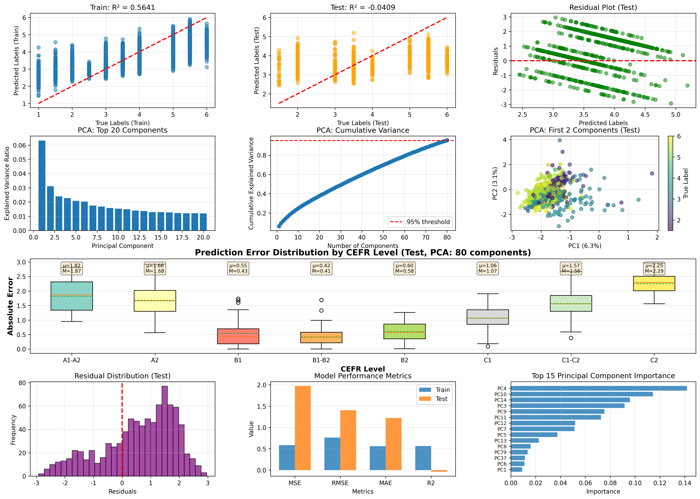

<em>Figure 11. 10-Class – Gradient Boosting.</em>

Description: _Write your description here._

[↑ Back to table](#10c-table)

#### Random Forest

  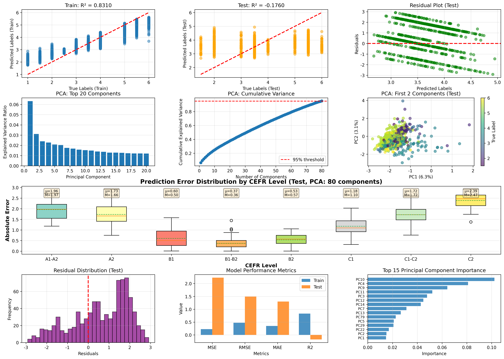

<em>Figure 12. 10-Class – Random Forest.</em>

Description: _Write your description here._

[↑ Back to table](#10c-table)

#### Lasso

  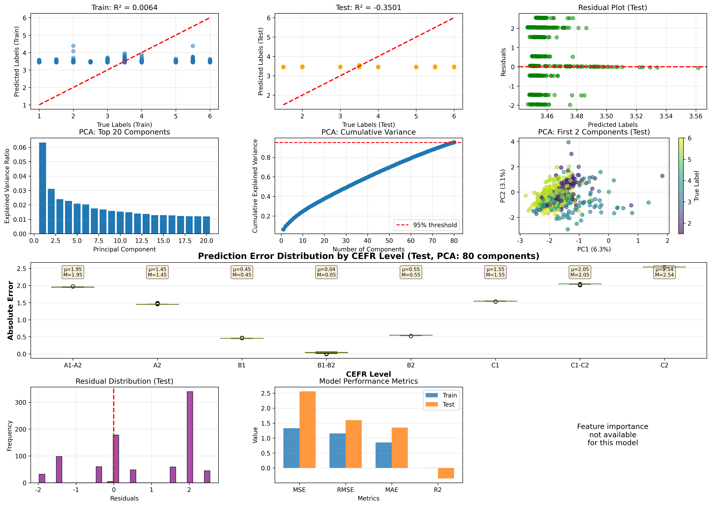

<em>Figure 13. 10-Class – Lasso.</em>

Description: _Write your description here._

[↑ Back to table](#10c-table)

#### Ridge

  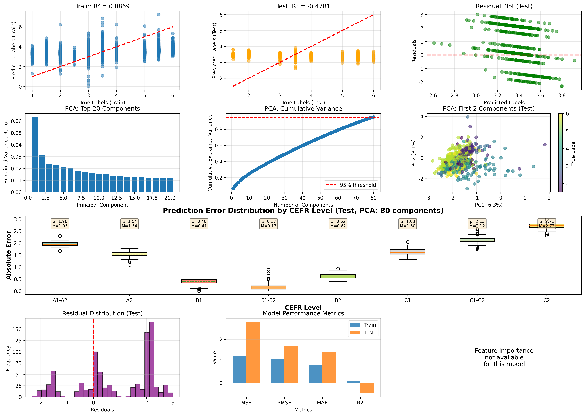

<em>Figure 14. 10-Class – Ridge.</em>

Description: _Write your description here._

[↑ Back to table](#10c-table)

#### SVR

  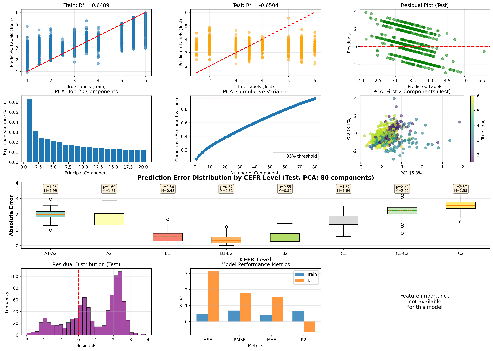

<em>Figure 15. 10-Class – SVR.</em>

Description: _Write your description here._

[↑ Back to table](#10c-table)

---

## Metrics

- **MSE** (Mean Squared Error), **RMSE** (Root Mean Squared Error), **MAE** (Mean Absolute Error): lower is better ↓
- **R²** (Coefficient of Determination): closer to 1 is better ↑; a negative value means the model performs worse than simply predicting the mean